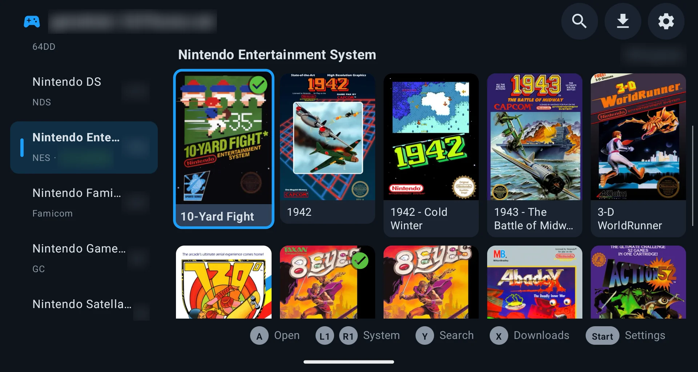
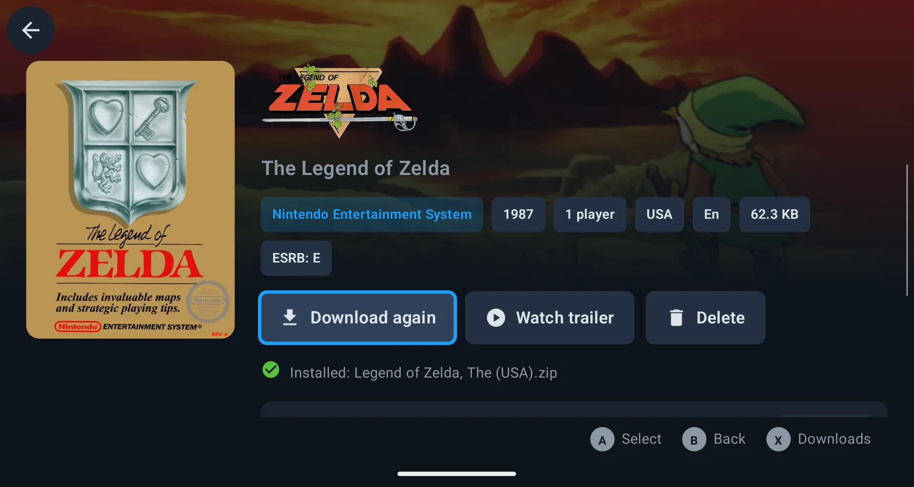
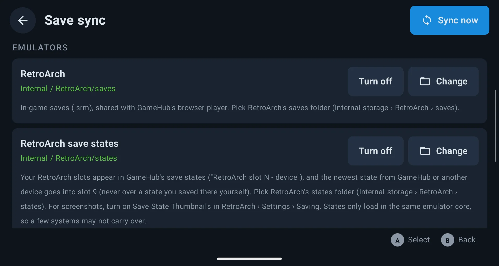
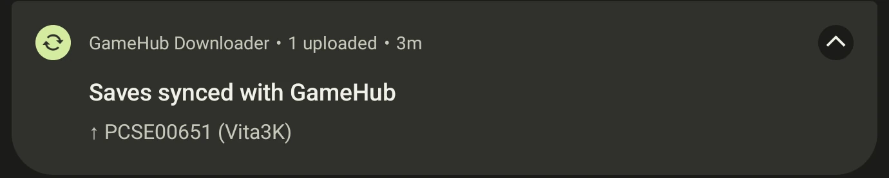

# GameHub Downloader

A controller-first Android app (styled like the Steam Deck UI) for browsing a [GameHub](../GameHub) server and downloading ROMs to your handheld. It is designed for the **AYN Thor** but adapts to any Android 10+ device in landscape or portrait.

<table>
  <tr>
    <td width="50%"><br/><sub><b>Browse</b> — systems down the side, box art grid, installed games marked</sub></td>
    <td width="50%"><br/><sub><b>Game</b> — details, download, trailer and delete</sub></td>
  </tr>
  <tr>
    <td width="50%"><br/><sub><b>Save sync</b> — RetroArch saves and states, PPSSPP, Azahar and more</sub></td>
    <td width="50%" valign="top"><br/><sub><b>Notifications</b> — what each sync uploaded or downloaded</sub></td>
  </tr>
</table>

## Features

- **GameHub connections.** Add one or more servers. Pair by QR (GameHub's device-pairing flow: scan with a signed-in phone or PC, then tap Approve) or paste an API token from *Account › API tokens*. Switch servers from the top bar or with Select.
- **Per-system download folders.** The first time you download for a system, the app asks where to save it. You can pick a dedicated folder, or pick a ROMs base folder so each system gets a subfolder named after its slug (`ROMs/snes`, `ROMs/gba`, …). Manage all of them in *Settings › Download folders*, including "use base folder for all unset systems".
- **Background downloads.** Downloads run in a foreground service and hold a wake lock and Wi‑Fi lock, so they keep going with the screen off or the device asleep.
  - Interrupted transfers resume with HTTP `Range` and retry automatically after a network drop.
  - Files are written as `name.part` and renamed when complete.
- **Notifications.** You get live progress with a Cancel action, a completed or failed alert for each game, and a summary when the queue empties.
- **PS Vita and Vita3K.** Set Vita3K's storage folder (the one holding `ux0`) in *Settings › Vita3K*. Vita zips are never extracted. Instead, each download is processed like this:
  - The game is installed straight into Vita3K's `ux0`. Zips in "installed layout" (`app/`, `patch/`) and zips with the game at the root both work.
  - A Daijishou Player Template `.dpt` (`[vita_game_id] <TITLE_ID>`) is written next to the zip with the same name, for Cocoon FE to scrape and launch.
  - The zip is then deleted.
  - Encrypted dumps need their license: a `sce_sys/package/work.bin` in the zip is copied to `ux0/license`. Without one, the install is refused and an existing install is left alone.
  - *Folders › Sync with Vita3K* installs leftover zips and creates `.dpt` files for games already in Vita3K.
  - Delete removes the `.dpt` and the Vita3K install and keeps save data. Games can be played in Vita3K from their page.
- **Save sync** (*Settings › Save sync*, needs GameHub 0.1.8+; save states need 0.1.9+). Pick each emulator's save folder once; saves then sync when the app opens (at most every 10 minutes), from **Sync now**, or per game from its page.
  - **RetroArch:** `saves/<core>/<ROM name>.srm` ↔ GameHub's battery save for that game, the same slot the browser player uses, so you can continue a game in either place. Games are paired by ROM file name.
  - **RetroArch save states** (best effort, needs GameHub 0.1.9+): each slot you save (`.state`, `.state1`…, compressed or not) appears in GameHub's save-state list as "RetroArch slot N - device", replacing that slot's previous upload, with its screenshot when RetroArch's *Save State Thumbnails* is on. The newest state made elsewhere (the browser, another device) is written to **slot 9**, only if slot 9 is empty or was filled by sync. States only load in the same emulator core, so some systems may not carry over.
  - **PPSSPP, Vita3K, Azahar, DS:** each game's save folder (PSP `SAVEDATA/<game id>*`, Vita `ux0/user/00/savedata/<title id>`, 3DS `title/…/data`, DS `<ROM>.sav`) is uploaded as a GameHub *device save* and restored on other devices.
  - The side that changed since the last sync wins. If both changed, the save is listed under **Needs attention** and you pick which copy to keep. Uploads are conditional (`If-Match`), so another device's newer save is never overwritten, and local saves are backed up (last 5 per game, in app storage) before being replaced.
  - DuckStation, AetherSX2 and Dolphin keep saves in their private `Android/data` folder, which other apps can't read.
- **Play.** Installed games get a **Play** button that starts them in an emulator on the device, using the same emulator list as Cocoon FE (served by GameHub 0.1.11+; older servers use a built-in list): RetroArch with any core, DuckStation, AetherSX2/NetherSX2, PPSSPP, Dolphin, melonDS, Azahar/Lime3DS, Eden and many more. The RetroArch core you already use for a system is picked by default; *Change* on the game page picks another emulator for that system.
- **Compatibility.** After you've played a game for a few minutes with Play, the app asks once how it ran in that emulator (Playable, Runs with issues, Broken). Answers go to GameHub (0.1.13+) per emulator and device, and the game page shows them with the official lists (RPCS3, Vita3K, PCSX2). If your usual emulator for a system is rated Broken for a game and another installed one Playable, Play uses that one.
- **Playtime.** Games started with Play show as "now playing" on GameHub, and the time is added to the game's playtime when you come back to the app. With Android's *usage access* (Settings › Track playtime › Allow usage access) it's how long the emulator was actually on screen; otherwise the time until you return (up to 4 hours).
- **Favorites and collections.** Browse your GameHub favorites and collections from the top of the systems rail, star games from their page, and **Download all** to queue everything in a collection, your favorites or a system that isn't on the device yet.
- **Free space.** Downloads that won't fit are refused up front (the "Download all" check adds up the whole batch), and *Settings › Download folders* shows each drive's free space and how much each system's folder uses.
- **BIOS & firmware** (*Settings › BIOS & firmware*). Installs the BIOS files stored in GameHub's *Settings › Firmware* into every emulator on the device that uses them: RetroArch's system folder (exact core file names) and the BIOS folder of standalone emulators such as DuckStation, AetherSX2/NetherSX2/ARMSX2, melonDS, Azahar/Lime3DS, Flycast, Yaba Sanshiro and Eden. Pick each emulator's folder once; files already there are skipped. With GameHub 0.1.12+ it also copies system firmware and keys: PS Vita and PS3 firmware (PUPs) for Vita3K and aPS3e/RPCS3, Switch keys and firmware (the .zip or the `Firmware` folder of .nca files) for Eden, and 3DS and Wii U keys; finish with the emulator's own *Install firmware* / *Install keys*.
- **Background save sync.** Besides "when the app opens", saves can sync every 1–24 hours in the background (optionally only on Wi-Fi), with a notification when something changed.
- **Updates.** The app checks GitHub Releases at start-up and offers newer versions; Android asks before installing. *Settings › Updates › Check now* checks on demand.
- **Second screen.** On two-screen devices like the AYN Thor, the other screen shows the selected game's art and details, plus download progress, while the app is open.
- **Adaptive layout.** Landscape shows a systems rail plus a cover grid. Portrait, and narrow screens like the Thor's second display, show system tabs plus a grid.

## Controls

Default (auto) mapping:

| Button | Action |
|---|---|
| D-pad / stick | Move focus |
| A | Select |
| B | Back / close dialog |
| L1 / R1 | Previous / next system |
| Y | Search |
| X | Downloads queue |
| Start | Settings |
| Select | Switch connection |

**Settings › Controller mapping** works like this:
- **Auto-detection:** each controller is recognized when you first press a button on it, and a toast confirms which one was detected. Mappings are saved per controller.
- **Remapping:** select an action, then press the button you want for it. If that button is already used, the two actions swap.
- **Layout presets:** Standard (A confirms) or Nintendo-style (A↔B and X↔Y swapped).
- **Testing and reset:** a live button tester shows what each press does, and **Reset to auto** restores the defaults.

On-screen button hints always show your current mapping.

## Build and install

Requirements: JDK 17+ and Android SDK 35 (`local.properties` points at the SDK).

```sh
./gradlew assembleDebug
adb install -r app/build/outputs/apk/debug/app-debug.apk
```

On the Thor, enable *Developer options › USB debugging*, then plug it in.

## GameHub API used

| Endpoint | Purpose |
|---|---|
| `GET /api/heartbeat` | Connection test (returns `user` when the token is valid) |
| `GET /api/platforms` | Systems list |
| `GET /api/library?platform=&q=&offset=&limit=` | Game grid (paged) |
| `GET /api/roms/{id}` | Game details |
| `GET /api/roms/{id}/file?download=1` | ROM download (supports `Range`) |
| `GET /api/roms/{id}/discs` | Multi-disc game as a single zip (no resume) |
| `GET /api/media/...?w=` | Box art thumbnails |
| `POST /api/pair/start`, `POST /api/pair/{id}/poll` | QR device pairing (requests a `viewer`-scope token) |
| `GET /api/saves` | Every save of the signed-in user with its SHA-256 and updated time |
| `POST /api/saves/match` | Pairs save file names (`<ROM name>.srm`) with library games |
| `GET/POST /api/roms/{id}/save` | Battery save download / conditional upload (`If-Match`, `If-None-Match: *`) |
| `GET/POST /api/device-saves/{platform}/{key}` | Device save (zip) download / conditional upload |
| `GET /api/library?tab=favorites`, `?collection={id}` | Favorites and collection grids |
| `GET /api/collections`, `POST /api/roms/{id}/favorite` | Collections list, star / unstar |
| `GET/POST /api/roms/{id}/compat` | Game compatibility and your rating per emulator and device (0.1.13+) |
| `GET /api/emulators` | Android emulators per system (Cocoon FE's list) and where standalone emulators read BIOS files (0.1.11+) |
| `GET /api/firmware`, `GET /api/firmware/{id}` | BIOS files on GameHub, and downloading one |
| `POST /api/roms/{id}/heartbeat`, `/playtime`, `/stop-playing` | "Now playing" and playtime for games started with Play (`/playtime` needs 0.1.11+; older servers get one heartbeat per minute) |

Every request sends `Authorization: Bearer ghk_…`.

## Known limitations (server side)

- **CUE/BIN games:** GameHub indexes only the `.cue`, so only the cue sheet downloads. The app warns about this on the game page.
- **Multi-disc zips** have no `Content-Length` or `Range` support, so they show indeterminate progress and restart from zero if interrupted.
- **Folder-based games** (for example Wii U) return HTTP 415 and can't be downloaded.
